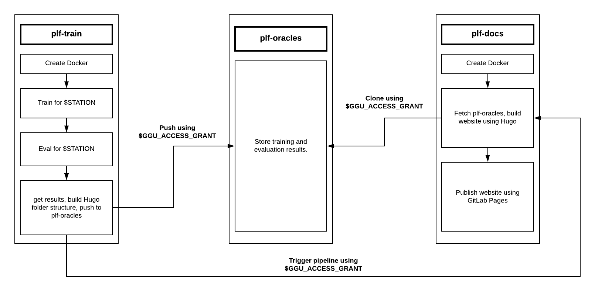

# Load forecasting on GitLab CI/CD

This Repository utilizes GitLab's CI/CD to train and evaluate RNN-Models in the cloud. Training has to be initiated manually by a user via [api](https://docs.gitlab.com/ee/api/pipelines.html#create-a-new-pipeline) or [web call](https://git.rwth-aachen.de/acs/public/automation/plf/plf-training/-/pipelines/new).

Additionally, after every commit (except the commit message contains "[skip ci]"), a linting and testing pipeline is created automatically to make sure
the project still works as intended and follows previously defined code conventions.

The CI uses multiple bash and python scripts each designed for one specific purpose. Those scripts can be found in the `shell/` folder.

## Structure

The CI implementation of this Repository features two different types of pipelines, one with three and one with four stages.

### Training Pipeline 



#### Overview

The pipeline is organized into several automated stages that together build, train, evaluate, and publish model results and documentation.

The **first stage (`prepare`)** builds and publishes reusable Docker images that contain all dependencies required for subsequent jobs.  
This includes the `plf-util` Python package and other required libraries.  
Images are rebuilt only when the Docker configuration or dependencies change, or if no cached image exists (e.g. on first run).

The **second stage (`training`)** uses the Docker image from the previous step to run the `train.py` script.  
This stage performs model training for a specified station, using configuration files defined in `./targets/${CI_STATION}/config.json`.  
The resulting model and logs are saved as GitLab artifacts under `./oracles`, `./runs`, and `./logs`.

The **third stage (`evaluation`)** takes the trained model artifacts from the `training` stage and runs the `evaluate.py` script.  
This evaluation is automatically aligned with the station used during training to ensure consistency.  
The generated evaluation metrics and files are stored again as artifacts within `./oracles`.

The **fourth stage (`oracles:deploy`)** runs the `push_to_oracles` job, which collects all artifacts from training and evaluation.  
It organizes them into a timestamped directory structure and pushes them to the external `plf-oracles` repository.  
Each directory represents a unique training run and includes models, logs, and an auto-generated `index.md` file linking to the original GitLab pipeline.

After publishing to `plf-oracles`, the **documentation pipeline** (`pdoc`, `build`, `deploy`) is triggered.  
This regenerates the project website by pulling the latest results from `plf-oracles` and embedding them under the **Results** tab.  
Each result page includes a direct link back to the originating pipeline, and a reference to the corresponding results page is also saved as an artifact.


#### Used scripts
The pipeline utilizes multiple scripts found in the `shell/` folder. Those scripts and their uses are explained here:

|Script Name|Function|
|---|---|
|adjust_config_for_technical_test.py|Changes parameters in the config such that the training will run quickly|
|return_timestamp.py|Prints current timestamp in format yyyy-mm-dd_hh-mm-ss to command line|
|create_hugo_header.py|Creates the front matter for Hugo's `_index.md` files to generate structure used in docs/results web page|
|make_station_folder_index.py|Splits $STATION into subfolders at "/" characters and create hugo header for each|
|lint_script.sh| Run flake8 linting for the `src/` folder and automatically convert its output to junit xml|

#### Stage descriptions
The CI/CD pipeline consists of the following stages:
* `prepare`: Builds and pushes docker images from the docker files in ./docker that will be used in the next stages
* `check`: Performs the Developer Certificate of Origin (DCO) check using `dco-check` to ensure commits are properly signed according to contribution standards. 
* `lint`: Uses `flake8` to lint the src and saves its output as a junit report. This report is automatically fetched by GitLab and presented in the [Tests](https://git.rwth-aachen.de/acs/public/automation/plf/plf-training/-/pipelines/345561/test_report) tab. Error and warning ignores for flake8 can be defined in the `.flake8` file within the repository's root directory.
* `training`: Runs model training with the train.py script with adjusted config using adjust_config_for_technical_test.py using data in ./data
* `evaluation`: Evaluates trained models using `evaluate.py`.  
* `oracles:deploy`: Packages and publishes training and evaluation outputs for each run.
* `pdoc`: Generates API reference documentation using `pdoc` for the `proloaf` module.  
* `build`: Builds the Hugo documentation site (Docsy theme)
* `deploy`: Prepares and deploys documentation to GitLab Pages:

## Requirements

To be able to  use this CI implementation when forking, there have to be configured runners with a `docker` environment accessible to the Repository. The tags assigned to these runners should also be `docker`.

To make the training pipeline work in a forked project, `plf-oracles` has to be forked as well or equivalent repositories have to be set up manually. Also, an api access token of an authorized user has to be given as environment variable in the `proloaf`-fork's pipeline.

## Usage

To trigger a training pipeline, either an [api](https://docs.gitlab.com/ee/api/pipelines.html#create-a-new-pipeline) or [web call](https://git.rwth-aachen.de/acs/public/automation/plf/plf-training/-/pipelines/new) can be used.

##### using the GitLab API
When triggering a pipeline by using GitLab's API, the config path has to be specified as a variable with the name `STATION` when performing the call. Such an API call could look like this if using a [pipeline trigger](https://docs.gitlab.com/ee/api/pipeline_triggers.html):

```bash
curl -X POST \
     -F token=TOKEN \
     -F "ref=REF_NAME" \
     -F "variables[STATION]=opsd" \
     https://your-gitlab-instance.com/api/v4/projects/your-project-id/trigger/pipeline
```
The Token can be aquired under `Settings/CI_CD/Pipeline_Triggers`. GitLab's API offers far more than just triggering pipelines, in fact it can perform every action that can be performed manually using the Web-UI. For further reading look up [GitLab's API Documentation](https://docs.gitlab.com/ee/api/README.html).

When using a [Personal Access Token](https://docs.gitlab.com/ee/user/profile/personal_access_tokens.html) with api rights, the call could look like this:

```bash
curl --request POST --header "PRIVATE-TOKEN: <your_access_token>" "https://your-gitlab-instance.com/api/v4/projects/1/pipeline?ref=<REF_NAME>"
```

##### using the GitLab web interface
To trigger a pipeline via the GitLab web interface, navigate to [Project/CI_CD/Pipelines -> Run Pipeline](https://git.rwth-aachen.de/acs/public/automation/plf/plf-training/-/pipelines/new). There, select the branch to train for and enter `STATION` as variable name and e.g. `opsd` as value.
